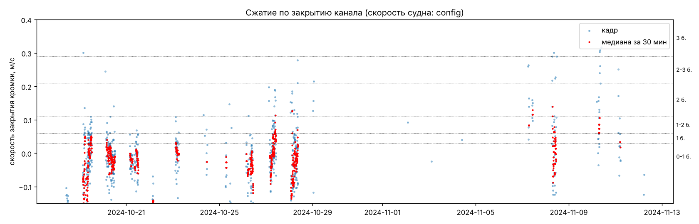

# Сжатие льда по закрытию канала (прототип)

Участок канала на дистанции Z за кормой прорезан Z/V секунд назад, поэтому наклон ширины по
дистанции даёт скорость закрытия одной кромки:

    v = −(dW/dZ) · V / 2        (dW/dZ по 100–250 м за кормой, V — скорость ледокола)

v переводится в балл по таблице скорости закрытия канала (медиана за 30 минут):

| v, м/с | < 0.03 | 0.03–0.06 | 0.06–0.11 | 0.11–0.21 | 0.21–0.29 | > 0.29 |
|---|---|---|---|---|---|---|
| балл | 0–1 | 1 | 1–2 | 2 | 2–3 | 3 |

Отрицательная v — канал с удалением расширяется (сжатия нет).

Кадр не используется, если: судно сзади ближе 500 м (`vessel`), поворот > 3° (`turn`), нет
скорости (`no_speed`) или она < 2 м/с (`slow`), мало строк в зоне 100–250 м (`few_rows`).



Прогон по рейсу 18.10–15.11.2024 **со скоростью, условно принятой 5 м/с**:
годных кадров 1035 из 3759 (1378 отброшены из-за судна сзади). Почти все дни — 0–1 балл;
7.11 и 10.11 — 1–2 балла (канал за кормой сужается ~3–5 м на 100 м). 29.10–6.11 оценки нет:
всё время судно сзади в 300–400 м.

На синтетике с известным закрытием (0 / 0.05 / 0.15 м/с) скорость восстанавливается с точностью
±0.01 м/с. Шум по одному кадру на реальных данных около ±0.05 м/с, поэтому балл — по медиане за 30 мин.

## Скорость судна

Скорость берётся из навигационных данных (NMEA): icescanner пишет их в свой лог `icescanner.log`
внутри каждого архива (`ground_speed` в узлах, время в UTC). Скорость общая для судна, поэтому годятся
архивы любых лидаров. `analytics/nmea_speed.py` собирает её в таблицу «время — скорость» (местное
время, UTC+3), а `process --speed-csv` подставляет скорость каждому кадру по времени.

В архивах рейса скорость нашлась только за 1–2 и 14–15 ноября (медиана 6,1 уз ≈ 3,1 м/с), а в эти дни
сжатие по кадрам не измеряется (судно сзади или нет канала). Поэтому для рейса взята медианная скорость
3,1 м/с: 7.11 и 10.11 — 1 балл, остальные дни 0–1. Для точных баллов нужна выгрузка NMEA за весь рейс.

```bash
python analytics/nmea_speed.py /путь/к/архивам -o out/speed.csv
python -m icechannel process --masks analytics/baseline/masks -c config/config.example.yaml \
    -o out/compression --no-overlays --speed-csv out/speed.csv     # или --speed 3.1
python analytics/compression_report.py --results out/compression/results --plot out/compression.png
```

Проверка: отметки о сжатии из ледового журнала за тот же рейс.
